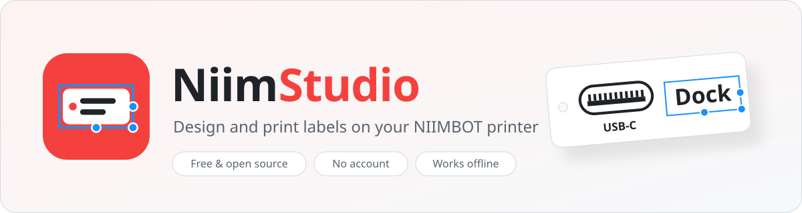
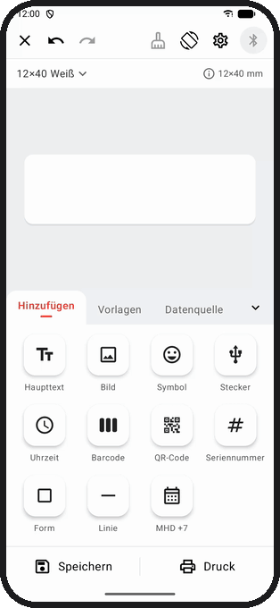
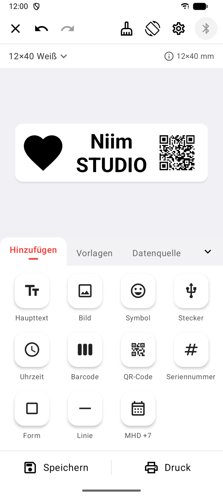
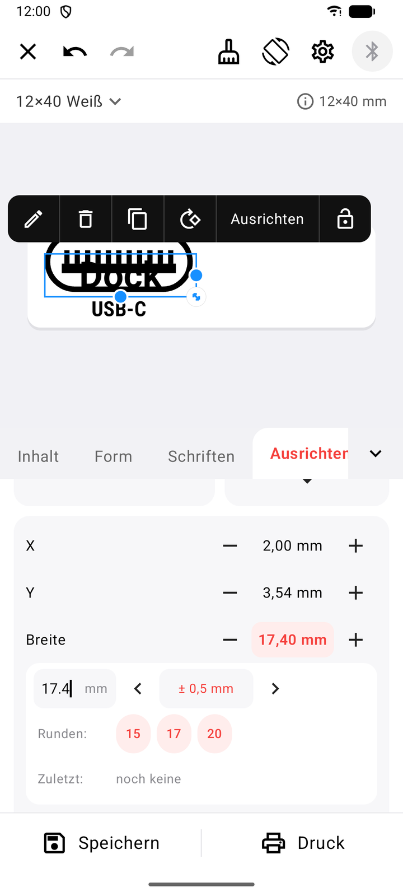
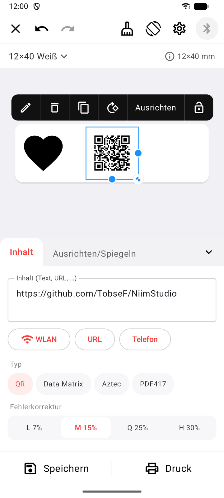
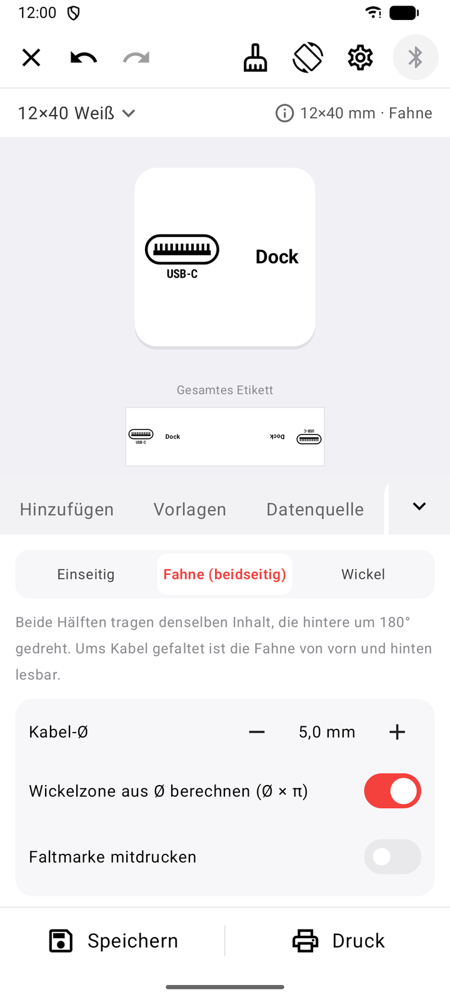
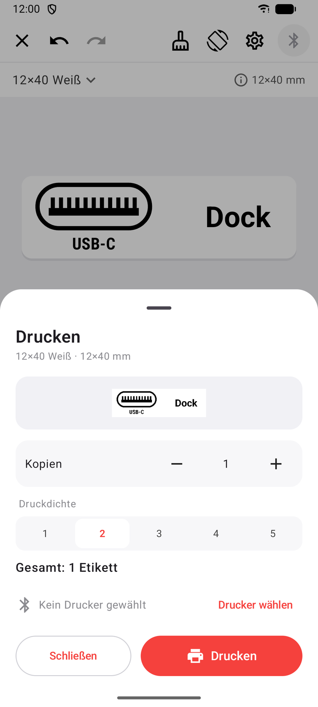

<p align="right">
  <a href="README.md"> English</a>
  &nbsp;·&nbsp;
   <b>Deutsch</b>
</p>

<p align="center">
  <picture>
    <source media="(prefers-color-scheme: dark)" srcset="docs/media/banner-dark.svg">
    
  </picture>
</p>

<p align="center">
  <a href="https://github.com/TobseF/NiimStudio/releases/latest"></a>
  
  <a href="LICENSE"></a>
  
</p>

<p align="center">
  <b>Der freie Etiketten-Designer für NIIMBOT-Drucker.</b><br>
  Kabelfahnen, Lager-Etiketten und Preisschilder am Handy gestalten und per Bluetooth drucken –<br>
  ohne Konto, ohne Cloud, ohne Werbung.
</p>

<p align="center">
  <a href="https://github.com/TobseF/NiimStudio/releases/latest"></a>
  <a href="https://apps.obtainium.imranr.dev/redirect?r=obtainium://add/https://github.com/TobseF/NiimStudio"></a>
</p>

<p align="center">
  
</p>

##  Funktionen

- **Was du siehst, wird gedruckt** – Drag & Drop, Pinch-Zoom, Hilfslinien zum Einrasten, Rückgängig/Wiederholen und eine 1-Bit-Druckvorschau, die exakt dem Etikett entspricht.
- **Alles, was ein Etikett braucht** – Text, Bilder, über 200 Symbole, Datum und MHD, Barcodes, QR-Codes, Seriennummern, Formen und Linien.
- **Präzises Layout** – am Etikett ausrichten, mit dem Steuerkreuz verschieben und jeden Wert direkt bearbeiten: mit Live-Vorschau, Runden und den zuletzt genutzten Werten.
- **Kabel-Etiketten** – 17 Steckersymbole (USB, HDMI, RJ45, DC …) und Kabelfahnen, die beidseitig bedruckt um das Kabel gelegt werden.
- **Profile & Vorlagen** – editierbare Etikettengrößen, Layouts als Vorlage mit Vorschaubild speichern.
- **Serien drucken** – Platzhalter aus einer Liste oder CSV füllen oder Etiketten automatisch nummerieren.
- **Privat** – läuft komplett offline, kein Konto, nicht einmal eine Internet-Berechtigung.
- **Deine Sprache** – Deutsch und Englisch, weitere Sprachen lassen sich leicht ergänzen.

##  Screenshots

<table>
  <tr>
    <td align="center"><br><sub>Alle Elemente</sub></td>
    <td align="center"><br><sub>Symbolbibliothek</sub></td>
    <td align="center"><br><sub>QR-Codes</sub></td>
    <td align="center"><br><sub>Fanglinien</sub></td>
    <td align="center"><br><sub>Druckvorschau</sub></td>
  </tr>
</table>

##  Download & Installation

NiimStudio läuft ab **Android 8.0** und braucht Bluetooth. Wähle den Weg, der dir am besten passt:

| | So geht's | Updates |
|---|---|---|
| **GitHub Releases** | `NiimStudio-<version>-release.apk` aus dem [neuesten Release](https://github.com/TobseF/NiimStudio/releases/latest) laden und öffnen. | manuell |
| **Obtainium** | NiimStudio mit einem Tipp [zu Obtainium hinzufügen](https://apps.obtainium.imranr.dev/redirect?r=obtainium://add/https://github.com/TobseF/NiimStudio). | automatisch |
| **Komi Store** | Im [Komi Store](https://github.com/komi-store/komi-store) (früher GitHub Store) nach **NiimStudio** suchen. | automatisch |
| **F-Droid** | Demnächst. | automatisch |

<details>
<summary><b>Mit Obtainium installieren</b></summary>

1. [Obtainium](https://github.com/ImranR98/Obtainium) installieren (über F-Droid oder die GitHub-Releases).
2. Am Handy oben auf das Badge **Get it on Obtainium** tippen – oder in Obtainium **App hinzufügen** wählen und
   `https://github.com/TobseF/NiimStudio` einfügen.
3. **Installieren** tippen. Obtainium prüft GitHub auf neue Versionen und bietet jedes Update an.

</details>

<details>
<summary><b>Mit Komi Store installieren</b></summary>

1. [Komi Store](https://github.com/komi-store/komi-store) (früher GitHub Store) installieren – über
   [F-Droid](https://f-droid.org/packages/zed.rainxch.githubstore/) oder die GitHub-Releases.
2. Nach **NiimStudio** suchen (oder das Repository `TobseF/NiimStudio` öffnen).
3. **Installieren** tippen. Komi Store hält die App aktuell.

</details>

<details>
<summary><b>F-Droid</b></summary>

<a href="#"></a>

NiimStudio ist für F-Droid vorbereitet (Store-Texte und Grafiken in `fastlane/`). Der Link erscheint hier,
sobald die App veröffentlicht ist.

</details>

##  Unterstützte Drucker

| Drucker | Status |
|---|---|
| **NIIMBOT B18** | ✅ getestet |
| Andere NIIMBOT-Modelle | funktionieren wahrscheinlich, wenn sie dasselbe Protokoll sprechen – ungetestet, [Rückmeldung willkommen](https://github.com/TobseF/NiimStudio/issues) |

##  Erster Druck in einer Minute

1. Drucker einschalten, NiimStudio öffnen und den Bluetooth-Zugriff erlauben.
2. Auf den **Bluetooth**-Knopf tippen und den Drucker wählen (z. B. `B18-…`).
3. Oben die Etikettengröße wählen (z. B. **12×40**), Text, Symbole oder Stecker hinzufügen.
4. **Druck** tippen.

---

##  Entwicklung

Kotlin, Jetpack Compose und Material 3. Voraussetzungen: JDK 17 und das Android SDK.

```bash
./gradlew assembleDebug          # app/build/outputs/apk/debug/NiimStudio-<version>-debug.apk
./gradlew testDebugUnitTest      # Unit-Tests (Protokoll, Layout, Übersetzungen)
```

| Ordner | Inhalt |
|---|---|
| `model/`, `data/` | Etikettenmodell und Speicherung |
| `render/` | ein Renderer für Editor und Drucker (8 Punkte/mm) |
| `printer/`, `protocol/`, `transport/` | Verbindung, NIIMBOT-Protokoll, SPP/BLE – siehe [Protokoll-Notizen](docs/protocol.md) (englisch) |
| `ui/` | Jetpack-Compose-Oberfläche |

<details>
<summary> <b>Sprache hinzufügen</b></summary>

1. `app/src/main/res/values/strings.xml` nach `app/src/main/res/values-<code>/strings.xml` kopieren (z. B. `values-fr`).
2. Die Texte übersetzen. Platzhalter wie `%1$s`, `%1$d` und `{N}` bleiben erhalten. Bei Symbolnamen
   (`sym_…`) steht nach `|` eine Liste von Suchbegriffen.
3. `./gradlew testDebugUnitTest` ausführen.

Mehr ist nicht nötig: Der Build erkennt den neuen Ordner und nimmt die Sprache in die Auswahl auf.
`TranslationsTest` meldet fehlende Schlüssel, abweichende Platzhalter sowie fehlende Plural- oder Array-Einträge.

</details>

<details>
<summary> <b>Steckersymbole bearbeiten oder ergänzen</b></summary>

Die Steckersymbole sind einfache SVG-Dateien in `app/src/main/assets/connectors/` (`usba.svg`, `hdmi.svg` …).
Mit einem Vektorprogramm (z. B. Inkscape) bearbeiten und die App neu bauen.

- Höhe 100 Einheiten (`viewBox="0 0 <Breite> 100"`), Umrisse schwarz mit `stroke-width="9"`, Kontakte als
  schwarze Flächen. Das Seitenverhältnis kommt aus der viewBox.
- Neuer Stecker: eine weitere SVG ablegen. Der Dateiname ist der Schlüssel; der Name kommt aus dem String
  `conn_<dateiname>`, falls vorhanden (übersetzbar), sonst aus dem `<title>` der SVG.
- Bestehende Dateien nicht umbenennen – gespeicherte Etiketten verweisen über den Namen darauf.

</details>

<details>
<summary> <b>Release veröffentlichen</b></summary>

Releases baut, signiert und veröffentlicht GitHub Actions ([release.yml](.github/workflows/release.yml)).
Die Builds sind reproduzierbar, F-Droid liefert deshalb genau dieselbe APK mit der Signatur des Autors aus.

1. `versionCode` und `versionName` in `app/build.gradle.kts` erhöhen.
2. `fastlane/metadata/android/en-US/changelogs/<versionCode>.txt` (und `de-DE`) anlegen.
3. Committen, mit dem versionName taggen (z. B. `0.7`) und das Tag pushen. GitHub Actions legt das
   Release mit der signierten APK an; F-Droid übernimmt das Tag automatisch.

Einmalig einrichten: die Repository-Secrets `NIIMSTUDIO_KEYSTORE_BASE64`, `NIIMSTUDIO_STORE_PASSWORD`,
`NIIMSTUDIO_KEY_ALIAS` und `NIIMSTUDIO_KEY_PASSWORD`. Für lokale Release-Builds
`keystore.properties.example` nach `keystore.properties` kopieren.

</details>
<details>
<summary> <b>Teaser-GIF, Screenshots und README-Grafiken aktualisieren</b></summary>

Teaser und Store-Screenshots werden automatisch im Emulator aufgenommen. Das Skript installiert die
Debug-APK, spielt per adb ein Storyboard ab (über sprachunabhängige Test-Tags), nimmt den Bildschirm auf und
macht daraus ein optimiertes GIF im Handy-Rahmen.

```bash
python tools/teaser/record.py --build              # Englisch + Deutsch, braucht adb, ffmpeg und Pillow
python tools/teaser/record.py --lang de            # nur eine Sprache
python tools/teaser/record.py --gif-only           # GIFs aus der letzten Aufnahme neu rendern
python tools/readme/make_assets.py                 # Banner, Icons, Flaggen, Store-Icon und Feature-Grafik
```

Ergebnis: `docs/media/teaser-<lang>.gif` und `fastlane/metadata/android/<locale>/images/`.

</details>

##  Danksagung

- Druckerprotokoll basierend auf [niimbluelib](https://github.com/MultiMote/niimbluelib) von MultiMote (MIT).
- Barcodes und QR-Codes: [ZXing](https://github.com/zxing/zxing) · SVG-Darstellung: [AndroidSVG](https://github.com/BigBadaboom/androidsvg) · Symbole: [Material Icons](https://fonts.google.com/icons) (Apache 2.0).

Alle Lizenzen stehen in [THIRD_PARTY_NOTICES.md](THIRD_PARTY_NOTICES.md).

##  Lizenz

NiimStudio ist freie Software unter der [GNU General Public License v3.0](LICENSE).

<sub>NiimStudio ist ein unabhängiges Projekt und steht in keiner Verbindung zu NIIMBOT, wird von NIIMBOT weder
unterstützt noch gesponsert. NIIMBOT ist eine Marke des jeweiligen Inhabers und wird hier nur zur Beschreibung
der Kompatibilität genannt.</sub>
