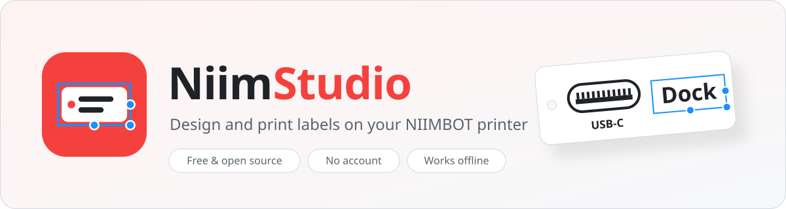
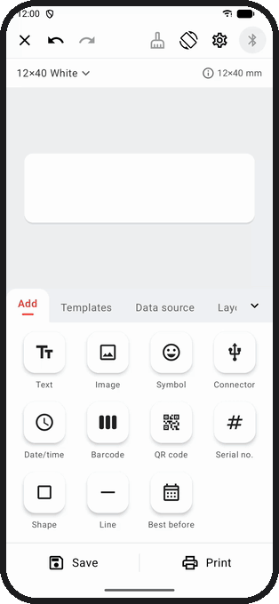
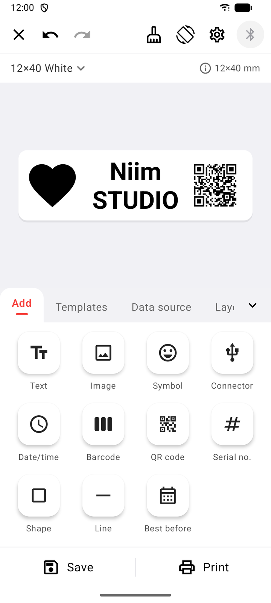
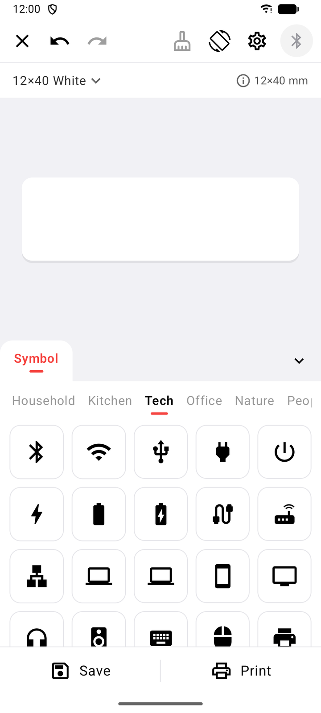
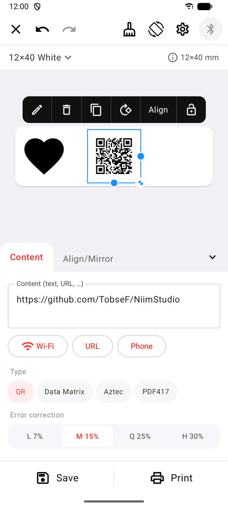
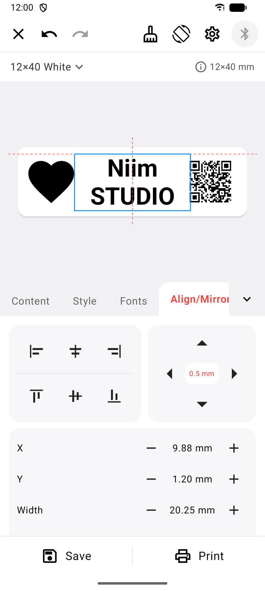
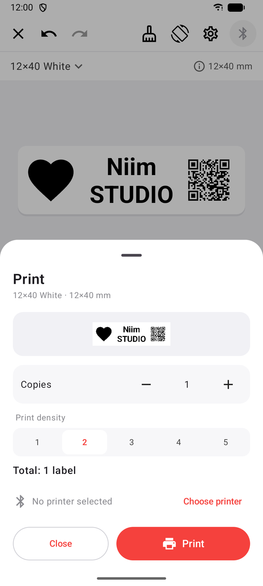

<p align="right">
   <b>English</b>
  &nbsp;·&nbsp;
  <a href="README.de.md"> Deutsch</a>
</p>

<p align="center">
  <picture>
    <source media="(prefers-color-scheme: dark)" srcset="docs/media/banner-dark.svg">
    
  </picture>
</p>

<p align="center">
  <a href="https://github.com/TobseF/NiimStudio/releases/latest"></a>
  
  <a href="LICENSE"></a>
  
</p>

<p align="center">
  <b>The free label designer for NIIMBOT printers.</b><br>
  Design cable flags, storage labels and price tags on your phone and print them over Bluetooth –<br>
  no account, no cloud, no ads.
</p>

<p align="center">
  <a href="https://github.com/TobseF/NiimStudio/releases/latest"></a>
  <a href="https://apps.obtainium.imranr.dev/redirect?r=obtainium://add/https://github.com/TobseF/NiimStudio"></a>
</p>

<p align="center">
  
</p>

##  Features

- **What you see is what you print** – drag & drop, pinch-zoom, snap guides, undo/redo and a 1-bit print preview that matches the label exactly.
- **Everything a label needs** – text, images, 200+ symbols, date & best-before, barcodes, QR codes, serial numbers, shapes and lines.
- **Precise layout** – align to the label, nudge with a move pad, and edit any value inline with live preview, rounding and your recent values.
- **Cable labels** – 17 connector symbols (USB, HDMI, RJ45, DC, …) and cable flags that are printed on both sides and wrap around the cable.
- **Profiles & templates** – editable label sizes, and layouts saved as templates with a preview.
- **Batch printing** – fill placeholders from a list or CSV, or number labels automatically.
- **Private by design** – works fully offline, no account, not even the internet permission.
- **Your language** – English and German, easy to add more.

##  Screenshots

<table>
  <tr>
    <td align="center"><br><sub>All elements</sub></td>
    <td align="center"><br><sub>Symbol library</sub></td>
    <td align="center"><br><sub>QR codes</sub></td>
    <td align="center"><br><sub>Snap guides</sub></td>
    <td align="center"><br><sub>Print preview</sub></td>
  </tr>
</table>

##  Download & install

NiimStudio runs on **Android 8.0 or newer** and needs Bluetooth. Pick whichever way you like:

| | How | Updates |
|---|---|---|
| **GitHub Releases** | Download `NiimStudio-<version>-release.apk` from the [latest release](https://github.com/TobseF/NiimStudio/releases/latest) and open it. | manual |
| **Obtainium** | [Add NiimStudio to Obtainium](https://apps.obtainium.imranr.dev/redirect?r=obtainium://add/https://github.com/TobseF/NiimStudio) with one tap. | automatic |
| **Komi Store** | Search for **NiimStudio** in [Komi Store](https://github.com/komi-store/komi-store) (formerly GitHub Store). | automatic |
| **F-Droid** | Coming soon. | automatic |

<details>
<summary><b>Install with Obtainium</b></summary>

1. Install [Obtainium](https://github.com/ImranR98/Obtainium) (from F-Droid or its GitHub releases).
2. On your phone, tap the **Get it on Obtainium** badge above – or open Obtainium, tap **Add app** and paste
   `https://github.com/TobseF/NiimStudio`.
3. Tap **Install**. Obtainium checks GitHub for new versions and offers each update.

</details>

<details>
<summary><b>Install with Komi Store</b></summary>

1. Install [Komi Store](https://github.com/komi-store/komi-store) (formerly GitHub Store) – from
   [F-Droid](https://f-droid.org/packages/zed.rainxch.githubstore/) or its GitHub releases.
2. Search for **NiimStudio** (or open the repository `TobseF/NiimStudio`).
3. Tap **Install**. Komi Store keeps the app up to date.

</details>

<details>
<summary><b>F-Droid</b></summary>

<a href="#"></a>

NiimStudio is prepared for F-Droid (store texts and graphics in `fastlane/`). The link will appear here once
the app is published.

</details>

##  Supported printers

| Printer | Status |
|---|---|
| **NIIMBOT B18** | ✅ tested |
| Other NIIMBOT models | probably work if they use the same protocol – untested, [feedback welcome](https://github.com/TobseF/NiimStudio/issues) |

##  First print in one minute

1. Switch the printer on and open NiimStudio. Allow Bluetooth access.
2. Tap the **Bluetooth** button and pick your printer (e.g. `B18-…`).
3. Choose your label size at the top (e.g. **12×40**), add text, symbols or connectors.
4. Tap **Print**.

---

##  Development

Kotlin, Jetpack Compose and Material 3. Requirements: JDK 17 and the Android SDK.

```bash
./gradlew assembleDebug          # app/build/outputs/apk/debug/NiimStudio-<version>-debug.apk
./gradlew testDebugUnitTest      # unit tests (protocol, layout, translations)
```

| Folder | Content |
|---|---|
| `model/`, `data/` | label model and persistence |
| `render/` | one renderer for the editor and the printer (8 dots/mm) |
| `printer/`, `protocol/`, `transport/` | connection, NIIMBOT protocol, SPP/BLE – see [protocol notes](docs/protocol.md) |
| `ui/` | Jetpack Compose screens |

<details>
<summary> <b>Add a language</b></summary>

1. Copy `app/src/main/res/values/strings.xml` to `app/src/main/res/values-<code>/strings.xml` (e.g. `values-fr`).
2. Translate the texts. Keep placeholders like `%1$s`, `%1$d` and `{N}`. Symbol names (`sym_…`) contain a
   list of search terms after `|`.
3. Run `./gradlew testDebugUnitTest`.

That's all: the build finds the new folder and adds the language to the picker. `TranslationsTest`
reports missing keys, mismatching placeholders and missing plural or array entries.

</details>

<details>
<summary> <b>Edit or add connector symbols</b></summary>

The connector symbols are plain SVG files in `app/src/main/assets/connectors/` (`usba.svg`, `hdmi.svg`, …).
Edit them in any vector editor (e.g. Inkscape) and rebuild the app.

- Height 100 units (`viewBox="0 0 <width> 100"`), black outlines with `stroke-width="9"`, contacts as
  black areas. The aspect ratio comes from the viewBox.
- New connector: add another SVG. The file name is the key; the name comes from the string
  `conn_<file name>` if present (translatable), otherwise from the SVG `<title>`.
- Don't rename existing files – saved labels refer to them by name.

</details>

<details>
<summary> <b>Publish a release</b></summary>

Releases are built, signed and published by GitHub Actions ([release.yml](.github/workflows/release.yml)).
The builds are reproducible, so F-Droid ships the very same APK with the author's signature.

1. Raise `versionCode` and `versionName` in `app/build.gradle.kts`.
2. Add `fastlane/metadata/android/en-US/changelogs/<versionCode>.txt` (and `de-DE`).
3. Commit, tag with the versionName (e.g. `0.7`) and push the tag. GitHub Actions creates the release
   with the signed APK; F-Droid picks up the tag automatically.

One-time setup: the repository secrets `NIIMSTUDIO_KEYSTORE_BASE64`, `NIIMSTUDIO_STORE_PASSWORD`,
`NIIMSTUDIO_KEY_ALIAS` and `NIIMSTUDIO_KEY_PASSWORD`. For local release builds copy
`keystore.properties.example` to `keystore.properties`.

</details>
<details>
<summary> <b>Update the teaser GIF, screenshots and README graphics</b></summary>

The teaser and the store screenshots are recorded automatically on an emulator. The script installs the
debug APK, plays a storyboard through adb (language-independent test tags), records the screen and turns it
into an optimised GIF inside a phone frame.

```bash
python tools/teaser/record.py --build              # English + German, needs adb, ffmpeg and Pillow
python tools/teaser/record.py --lang de            # one language only
python tools/teaser/record.py --gif-only           # re-render the GIFs from the last recording
python tools/readme/make_assets.py                 # banner, icons, flags, store icon and feature graphic
```

Outputs: `docs/media/teaser-<lang>.gif` and `fastlane/metadata/android/<locale>/images/`.

</details>

##  Credits

- Printer protocol based on [niimbluelib](https://github.com/MultiMote/niimbluelib) by MultiMote (MIT).
- Barcodes and QR codes: [ZXing](https://github.com/zxing/zxing) · SVG rendering: [AndroidSVG](https://github.com/BigBadaboom/androidsvg) · Symbols: [Material Icons](https://fonts.google.com/icons) (Apache 2.0).

All licenses are listed in [THIRD_PARTY_NOTICES.md](THIRD_PARTY_NOTICES.md).

##  License

NiimStudio is free software under the [GNU General Public License v3.0](LICENSE).

<sub>NiimStudio is an independent project and is not affiliated with, endorsed or sponsored by NIIMBOT.
NIIMBOT is a trademark of its respective owner and is used here only to describe compatibility.</sub>
